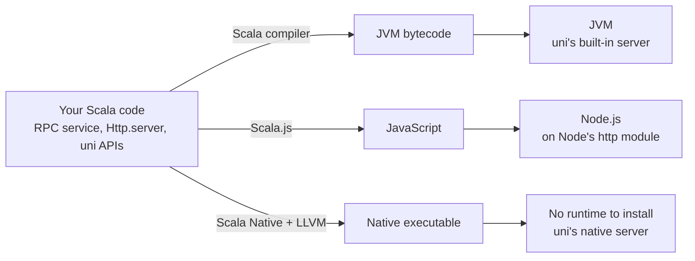

# Scala Without the JVM: Close to Rust's Speed, With 25x Less Memory Than the JVM

**Compiled with Scala Native, uni's HTTP server comes close to Rust and the JVM in throughput, while using about 25x less memory than the JVM.** Serving the same endpoint on the same machine, it reaches about 80% or more of the throughput of Rust with axum. It keeps pace with uni on the JVM on a small RPC response and reaches about 80% of it on a 3.4 KB one. It does this in 25–28 MB of memory, where the JVM build used 590–614 MB and 650 MB.

A day earlier, the native server was about 5x slower than the JVM on the small response and about 50x slower on the larger one. Scala Native itself wasn't the problem; allocation was. The Boehm garbage collector the server runs with serializes allocating threads on one lock, so every byte one request allocated slowed down the others. This post covers how we found that, what we changed, and how the result compares with the JVM, Node.js, Python, Ruby, and Rust serving the same endpoint on the same machine.

The bigger point: you can write Scala without being tied to the JVM. The same uni code runs on the JVM when you want its peak throughput, and as a small native binary when you want low memory and nothing to install.

![Scala Without the JVM: close to Rust's speed, with 25x less memory than the JVM. A hand-drawn highway runs left to right under an overhead sign with that title. On the left, cars labelled "req" queue at one small toll booth with a padlock, beside a sign listing the bottleneck: Boehm GC's global lock, 462 KB allocated per response, and 15 marker threads per collection. A speedometer sign shows uni on Scala Native going from 22.7k to 104k req/s on a small response and from 1.6k to 74k req/s on a 3.4 KB one. In the middle, a road crew widens the road beside a chalkboard of fixes: leaner headers and JSON, one GC marker thread, a 16 MB starting heap, and pooled buffers and zlib. On the right, a unicorn races a crab, a coffee cup, green hexagons, a ruby, and a snake toward a finish banner reading "Allocation was the bottleneck, not Scala Native". Signs show the 3.4 KB results (Rust 89k, JVM 94k, Node ×16 79k, uni Native 74k, Ruby ×16 45k, Python ×16 30k), memory on a luggage scale (uni Native 27 MB, JVM 650 MB, Node ×16 3 GB), and what's next: Immix GC in Scala Native 0.5.13.](/blog/native-server-performance.webp)

## Scala, without the JVM

[Scala Native](https://scala-native.org/) is an ahead-of-time compiler for Scala. Instead of JVM bytecode, it compiles your Scala code, the standard library, and its dependencies through LLVM into one native executable. That executable carries its own small runtime and garbage collector, so it runs without a JVM. You can choose between collectors at build time: Scala Native's own Immix and Commix, or Boehm, a conservative collector that is widely used from C.

Uni is built to cross-compile: its modules compile for the JVM, Scala.js, and Scala Native from one code base. An application written with uni, such as an RPC service with its HTTP server, can target the JVM or a native binary without rewriting anything. The choice of runtime becomes a deployment decision instead of a language decision. That only pays off if the native build is fast, which is what this post measures.



`Http.server` is the same call on every platform; uni picks the server for each one. This post measures the JVM and Scala Native builds. The Node.js rows in the comparison below are a plain Node.js server, not uni on Scala.js.

Here is a complete server, simplified from the rpc-native example, which also wires the server with `Design` so its tests can start it. Nothing in it is platform-specific:

```scala
import wvlet.uni.http.Http
import wvlet.uni.http.rpc.{RPCDispatcher, RPCRouter}
import wvlet.uni.weaver.Weaver

import java.util.concurrent.atomic.AtomicLong
import scala.collection.concurrent.TrieMap

case class Todo(id: Long, title: String, done: Boolean = false) derives Weaver

trait TodoApi:
  def add(title: String): Todo
  def complete(id: Long): Option[Todo]
  def list(): Seq[Todo]

class TodoApiImpl extends TodoApi:
  private val todos  = TrieMap.empty[Long, Todo]
  private val nextId = AtomicLong(0)

  def add(title: String): Todo =
    val todo = Todo(nextId.incrementAndGet(), title)
    todos.put(todo.id, todo)
    todo

  def complete(id: Long): Option[Todo] = todos.updateWith(id)(_.map(_.copy(done = true)))
  def list(): Seq[Todo]                = todos.values.toSeq.sortBy(_.id)

@main def serveTodos(): Unit =
  val router = RPCRouter.of[TodoApi](TodoApiImpl())
  Http.server.withPort(8080).withRxHandler(RPCDispatcher(router).dispatch).start().awaitTermination()
```

`derives Weaver` gives `Todo` its JSON and MessagePack codecs. `RPCRouter.of[TodoApi]` turns each method of the trait into an endpoint, such as `POST /example.rpc.TodoApi/list`, and `RPCDispatcher` serves them on whichever server `Http.server` starts. A client calls the service through the same `TodoApi` trait, so calls are checked at compile time.

## The starting point

The [rpc-native example](https://github.com/wvlet/uni/tree/main/examples/rpc-native) builds one typed RPC service, `TodoApi`, for both the JVM and Scala Native. On an Apple M5 Pro with 16 concurrent connections, the two builds served:

| Response | Native | JVM (uni's built-in server) |
|---|---|---|
| `list` with 1 todo (about 70 bytes) | 22.7k req/s | 102k–106k req/s |
| `list` with 50 todos (3.4 KB JSON, gzipped) | **1.6k req/s** | 74k–90k req/s |

That's about a 5x gap on the small response and about 50x on the larger one. The native server spent about 2 ms of CPU on each 50-item request, where the JVM spent about 110 µs.

## Where the time went

A CPU profile (`sample` on macOS) showed the workers barely running request code. They were waiting on one mutex inside Boehm's allocator: `GC_generic_malloc_many`, which refills a thread's free list, and `GC_malloc_kind_global`, which serves larger objects. Three facts about Boehm explain it:

- **Every array above about 400 bytes takes Boehm's global lock.** Only small objects come from per-thread free lists.
- **Collections stop every thread, while holding that lock.** With little live data, a server's heap stays at 2–3 MB, so Boehm collected every few hundred kilobytes of allocation, hundreds of times a second.
- **Boehm starts a marker thread for nearly every core.** On 18 cores, 15 markers handed under 1 MB of marking work back and forth on every collection.

So the cost of a request scaled with how much it allocated, and with how many other requests were allocating at the same time. The CPU profile couldn't tell which Scala code did the allocating, so we set an lldb breakpoint on Boehm's refill function and grouped the backtraces by caller. A refill happens once per block of allocation, which makes this a byte-weighted sample of every allocation site. It found 462 KB allocated for each 3.4 KB response.

## What we changed

Each fix came from that allocation profile, and each was measured before and after:

- **Smaller request and response handling** ([#981](https://github.com/wvlet/uni/pull/981)). `HttpMultiMap`, the header map, keeps entries in insertion-ordered arrays instead of two immutable maps. The response head is written straight to bytes. Common header names reuse shared strings. UTF-8 conversion has an ASCII fast path, because Scala Native's charset coders allocate per call.
- **A streaming JSON encoder for RPC results** ([#982](https://github.com/wvlet/uni/pull/982)). It writes JSON directly from the MessagePack form, without building a value tree and a string per node. Per-thread scratch buffers replace a packer that started at 10 bytes and doubled.
- **One Boehm marker thread by default** ([#983](https://github.com/wvlet/uni/pull/983)). A C constructor in uni calls `GC_set_markers_count(1)`, and `GC_MARKERS` still overrides it. This alone took the small response from 32k to 77k req/s.
- **JSON bytes without a `String` in between** ([#984](https://github.com/wvlet/uni/pull/984), [#986](https://github.com/wvlet/uni/pull/986)).
- **Pooled send buffers and zlib compressors** ([#985](https://github.com/wvlet/uni/pull/985)). Creating a `Deflater` per response set up about 256 KB of zlib state and freed it again.
- **A 16 MB Boehm heap when a server starts** ([#987](https://github.com/wvlet/uni/pull/987)). The heap no longer sits at 2–3 MB, collecting constantly. `GC_INITIAL_HEAP_SIZE` still overrides it, and command-line apps that never start a server keep Boehm's small default.

The 50-item response now allocates about 26 KB instead of 462 KB. The JVM runs the same shared server code and improved too, using about 25% less CPU per request on the 50-item response. One exception to sharing: the JVM's string conversions are intrinsified and faster than any hand-written loop, so uni keeps the standard library there and uses its own loops only on Scala Native and Scala.js.

## Next to other languages

For context, we wrote the same endpoint in Node.js, Python, Ruby, and Rust, each with a common production setup. Every server returns the same JSON, sorted by id and gzipped at 1 KB and above. The code is in [`examples/rpc-native/bench/other-servers`](https://github.com/wvlet/uni/tree/main/examples/rpc-native/bench/other-servers). Node.js, Python, and Ruby usually run one process per core in production, so we measured each both as a single process and as 16 processes, matching uni's 16 worker threads. Memory is the sum over all processes.

**50 todos (3.4 KB of JSON, gzipped):**

| Server | 16 connections | 64 connections | CPU per request | Memory |
|---|---|---|---|---|
| Rust (axum on tokio) | 89k req/s | 115k req/s | 58 µs | 14–24 MB |
| Uni on the JVM (built-in server) | 94k | 115k | 72 µs | 650 MB |
| Node.js, 16 processes | 79k | 114k | 68–99 µs | 3,045 MB |
| **Uni on Scala Native** | **74k** | **91k** | **97 µs** | **27 MB** |
| Ruby (Puma), 16 workers | 45k | 60k | 137 µs | 635 MB |
| Node.js, 1 process | 37k | 39k | 26 µs | 190 MB |
| Python (FastAPI on uvicorn), 16 workers | 30k | 58k | 254–293 µs | 940 MB |
| Ruby, 1 process with 16 threads | 15k | 16k | 80 µs | 56 MB |
| Python, 1 worker | 5k | 6k | 180–196 µs | 55 MB |

**1 todo (about 70 bytes):**

| Server | 16 connections | 64 connections | CPU per request | Memory |
|---|---|---|---|---|
| Rust (axum on tokio) | 125k req/s | 127k req/s | 21 µs | 6–9 MB |
| **Uni on Scala Native** | **104k** | **117k** | **32–40 µs** | **25 MB** |
| Uni on the JVM (built-in server) | 99k | 121k | 44–48 µs | 590–614 MB |
| Node.js, 1 process | 106k | 80k | 10–12 µs | 100–120 MB |
| Node.js, 16 processes | 95k | 114k | 43–49 µs | 1,250 MB |
| Ruby (Puma), 16 workers | 88k | 96k | 67–77 µs | 440 MB |
| Python (FastAPI on uvicorn), 16 workers | 75k | 97k | 108 µs | 940 MB |

On the small response, several servers hit the limit of the load generator, which shares the machine, so compare CPU per request there rather than requests per second.

## Reading the numbers

- **Rust with axum is the reference point.** It serves the most requests with the least CPU and memory. Uni on Scala Native reaches about 80% of its throughput at about 1.7x its CPU per request on the 3.4 KB response.
- **The JVM is still the fastest way to run uni on larger responses**, thanks to its JIT and thread-local allocation. Scala Native gives up about 20% of that throughput for a memory footprint about 25x smaller and a single binary with no JVM to install.
- **Node.js is remarkably efficient per request.** A single process used only 10–26 µs of CPU per request. Because it runs on one core, using the whole machine takes a cluster, and 16 processes used 3 GB here.
- **Python and Ruby are productive, mature choices.** FastAPI and Puma make web services quick to build, and with one process per core they serve tens of thousands of requests per second, plenty for many services.

In short, uni on Scala Native comes close to Rust on small responses, and close to the JVM on larger ones at a fraction of the JVM's memory. On the small response it also uses less CPU per request than the JVM.

## What's next

The remaining gap on larger responses is still Boehm's single allocation lock: each worker takes it to refill its free lists, about once per 4 KB it allocates. A bigger heap makes collections rare but doesn't remove that. Scala Native's own Immix collector allocates without a global lock, but before Scala Native 0.5.13 it isn't safe for a multithreaded server like this one. The fix ([scala-native#5159](https://github.com/scala-native/scala-native/pull/5159)) is merged for 0.5.13. Once that release is out, we plan to measure Immix on Linux and macOS and switch the recommendation if it holds up.

## How we measured

- **Machine:** Apple M5 Pro, 18 cores, 48 GB, macOS 27.2.
- **Load generator:** [oha](https://github.com/hatoo/oha) 1.16 on the same machine. Keep-alive connections, `POST /example.rpc.TodoApi/list` with a JSON body, gzip accepted. Each figure is one 8-second run after a 3-second warm-up. The machine also ran other work, so treat differences under about 10% as noise.
- **Uni:** the rpc-native bench binary (Scala Native 0.5.12, release-full mode, full LTO, Boehm GC with uni's defaults), and the JVM build on JDK 25 with uni's built-in server.
- **Others:** Node.js 24.22 (`http`, `cluster`); Python 3.15 with FastAPI 0.165 on uvicorn 0.54 (uvloop, httptools); Ruby 4.0.7 with YJIT, Rack on Puma; Rust 1.100 with axum 0.8, `serde_json`, and tower-http's gzip layer.
- **CPU per request:** the server's CPU time during the run divided by the requests served.

To reproduce uni's numbers, build the binary and JVM jars with [`examples/rpc-native/bench/build.sh`](https://github.com/wvlet/uni/tree/main/examples/rpc-native/bench). Start `out/rpc-native <port>` directly with no GC environment variables, so uni's defaults apply (`bench.py` sets `GC_INITIAL_HEAP_SIZE=64m`, which overrides them). Then add todos through `TodoApi/add` and run the same oha command. To reproduce the others, start the servers in `other-servers` with `ITEMS=51` (or `ITEMS=1`).
