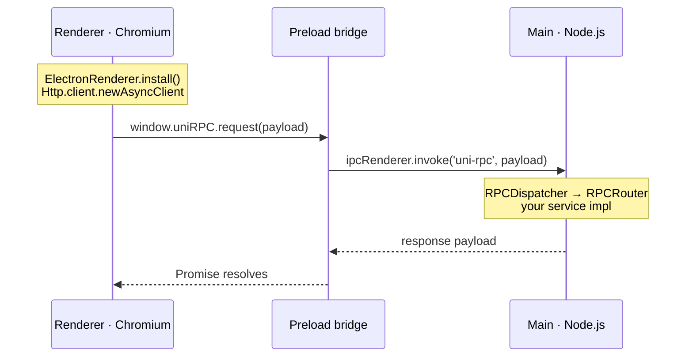

# Desktop Apps (Electron)

Build [Electron](https://www.electronjs.org/) desktop apps with Uni and Scala.js, and let the UI
call services in the main process using Uni's [RPC](/http/rpc) — tunneled over Electron's IPC
instead of a network socket. No HTTP server, no open ports.

The transport lives in the `wvlet.uni.electron` package and is **Scala.js only**
(`uni/.js`). A complete, runnable reference app is in
[`examples/electron-app`](https://github.com/wvlet/uni/tree/main/examples/electron-app).

::: tip New to this?
Start with the [Electron Tutorial](/http/electron-tutorial) — a step-by-step setup from an empty
directory. This page is the API reference for what the tutorial wires together.
:::

## How it fits together

Electron runs three contexts. Uni occupies two of them; the third is a tiny hand-written bridge:



- **Renderer** serializes each RPC request to a plain object and calls the preload bridge.
- **Preload** forwards it via `ipcRenderer.invoke` (context isolation stays on).
- **Main** dispatches it through the same transport-neutral `RPCDispatcher` that the HTTP server
  uses, and resolves the response payload.

Because the wire format is identical to HTTP RPC, your existing service traits and clients work
unchanged.

## The shared service

Define the service trait once and share it between both processes. Returning `Rx[A]` keeps calls
asynchronous, which suits IPC:

```scala
import wvlet.uni.rx.Rx

case class CounterState(value: Int)

trait CounterApi:
  def get(): Rx[CounterState]
  def increment(amount: Int): Rx[CounterState]
  def reset(): Rx[CounterState]
```

## Main process

Implement the service and register it on Electron's `ipcMain`. Electron objects are passed in as
values — this Scala module never has to `require("electron")`:

```scala
import wvlet.uni.electron.ElectronRPCServer
import wvlet.uni.http.rpc.RPCRouter
import wvlet.uni.rx.Rx
import scala.scalajs.js
import scala.scalajs.js.annotation.JSExportTopLevel

class CounterApiImpl extends CounterApi:
  private var value = 0
  def get(): Rx[CounterState]                  = Rx.single(CounterState(value))
  def increment(amount: Int): Rx[CounterState] = { value += amount; Rx.single(CounterState(value)) }
  def reset(): Rx[CounterState]                = { value = 0; Rx.single(CounterState(value)) }

object MainProcess:
  @JSExportTopLevel("wireMainProcess")
  def wireMainProcess(ipcMain: js.Dynamic): Unit =
    ElectronRPCServer.serve(ipcMain, RPCRouter.of[CounterApi](CounterApiImpl()))
```

Pass several routers to serve multiple services over the one channel:
`ElectronRPCServer.serve(ipcMain, RPCRouter.of[A](a), RPCRouter.of[B](b))`.

Electron delivers IPC calls from every frame of every window, including embedded iframes. By
default the server accepts calls only from top-level frames; a rejected call fails with
`PERMISSION_DENIED_U14`. Restrict callers to your own pages with `ElectronRPCServerConfig`:

```scala
import wvlet.uni.electron.ElectronRPCServerConfig

ElectronRPCServer.serve(
  ipcMain,
  ElectronRPCServerConfig()
    .withAllowedOrigins("file://", "http://localhost:5173"), // packaged app + Vite dev server
  RPCRouter.of[CounterApi](CounterApiImpl())
)
```

An origin matches the sender frame URL as a prefix at a path boundary, so `http://localhost:5173`
does not match `http://localhost:51730`. `withSenderFilter(frame => ...)` adds a custom check of the
`WebFrameMain`, and `withAllowSubFrames(true)` lets iframes call.

The JS main entry hands `ipcMain` over once the app is ready:

```js
import { app, ipcMain } from 'electron'
import { wireMainProcess } from 'scalajs:main.js'

app.whenReady().then(() => {
  wireMainProcess(ipcMain)
  // … createWindow() …
})
```

## Preload bridge

The single function the renderer transport expects. Keep context isolation on:

```js
import { contextBridge, ipcRenderer } from 'electron'

contextBridge.exposeInMainWorld('uniRPC', {
  request: (payload) => ipcRenderer.invoke('uni-rpc', payload)
})
```

## Renderer

Call `ElectronRenderer.install()` once at startup. Afterward every `Http.client.newAsyncClient`
(and any generated RPC `AsyncClient`) sends through the IPC bridge:

```scala
import wvlet.uni.electron.ElectronRenderer
import wvlet.uni.http.Http
import wvlet.uni.http.rpc.RPCClient
import scala.scalajs.js.annotation.JSExportTopLevel

object RendererApp:
  private val rpc    = RPCClient.of[CounterApi]
  private lazy val client = Http.client.newAsyncClient

  @JSExportTopLevel("main")
  def main(): Unit =
    ElectronRenderer.install() // wires window.uniRPC as the HTTP channel factory
    rpc.callAsync[CounterState](client, "increment", Seq(1)).run { state =>
      println(s"counter = ${state.value}")
    }
```

`install()` defaults to `window.uniRPC`; pass a different bridge object if your preload exposes
another name: `ElectronRenderer.install(myBridge)`.

::: tip Async only
A sandboxed renderer has no synchronous IPC, so the Electron channel implements only the async path.
Use `Http.client.newAsyncClient`; `newSyncClient` throws.
:::

## Build pipeline

The example uses [`electron-vite`](https://electron-vite.org/) with
[`@scala-js/vite-plugin-scalajs`](https://www.scala-js.org/doc/tutorial/scalajs-vite.html). The
plugin links a Scala.js sbt project and exposes it to the bundle as `import 'scalajs:main.js'`; its
`projectID` selects which project (here, `main` and `renderer`):

```js
// electron.vite.config.mjs
import { defineConfig, externalizeDepsPlugin } from 'electron-vite'
import scalaJSPlugin from '@scala-js/vite-plugin-scalajs'

export default defineConfig({
  main:     { plugins: [externalizeDepsPlugin(), scalaJSPlugin({ cwd: '.', projectID: 'main' })] },
  preload:  { plugins: [externalizeDepsPlugin()] },
  renderer: { plugins: [scalaJSPlugin({ cwd: '.', projectID: 'renderer' })] }
})
```

Both Scala.js projects emit ES modules and export functions (no `main` initializer):

```scala
scalaJSLinkerConfig ~= { _.withModuleKind(ModuleKind.ESModule) }
scalaJSUseMainModuleInitializer := false
```

Then:

```bash
pnpm dev       # electron-vite: compile Scala.js, start the renderer dev server, launch Electron
pnpm package   # electron-vite build, then electron-builder → installers in dist/
```

Packaging is handled by [`electron-builder`](https://www.electron.build/) (dmg / nsis / AppImage).

::: warning JS dependency
Uni's Scala.js code uses `java.security.SecureRandom` (via ULID in the serialization layer), so a
desktop app pulls in `scalajs-java-securerandom` transitively from `uni`. If you depend on a Uni
release older than this feature, add it yourself:

```scala
libraryDependencies +=
  ("org.scala-js" %%% "scalajs-java-securerandom" % "1.0.0").cross(CrossVersion.for3Use2_13)
```
:::

## App size

An Electron app ships its own copy of Chromium. That is where most of the size comes from, and it is
also what Electron gives you: the same up-to-date engine, rendering, and DevTools on every OS, with
no dependency on the browser engine the user's OS happens to have. Measured on the example app
(Electron 45, macOS arm64):

| Part                                         | Size     | Can you drop it?                                     |
| -------------------------------------------- | -------- | ---------------------------------------------------- |
| Chromium core (`Electron Framework` binary)  | 197 MB   | No                                                   |
| SwiftShader (software GPU fallback)          | 16 MB    | Only if every user has a GPU; VMs and GPU-less machines may fail to render |
| ICU data, `.pak` resources, V8 snapshot      | 25 MB    | No                                                   |
| Locale folders (`*.lproj`)                   | 9 MB     | Yes — keep only the languages your UI supports       |
| Uni + app code (`app.asar`, Scala.js)        | 1.8 MB   | Minify it (3.9 MB unminified)                        |

The example applies the safe trims:

```yaml
# electron-builder.yml
compression: maximum
electronLanguages:
  - en
```

```js
// electron.vite.config.mjs — Scala.js output is not minified by default in main/renderer builds
main:     { plugins: [...], build: { minify: true } },
renderer: { plugins: [...], build: { minify: true } }
```

That takes the macOS DMG from 121 MB to 109 MB (−10%), and the installed app from 262 MiB to
251 MiB. The rest is Chromium itself. Other levers:

- **Build one architecture per installer.** A universal macOS build (arm64 + x64) carries two
  copies of Chromium. `electron-builder` builds for the host architecture unless you ask for
  `universal`.
- **Choose the shell for the tradeoff you need.** Electron fits apps that need a predictable engine.
  When download size matters more than engine consistency, shells that use the OS's own WebView,
  such as [Tauri](https://tauri.app/), are a good choice, and the same Uni RPC services can run
  behind any transport.

See the full project — sbt build, Vite config, preload, packaging — in
[`examples/electron-app`](https://github.com/wvlet/uni/tree/main/examples/electron-app).
