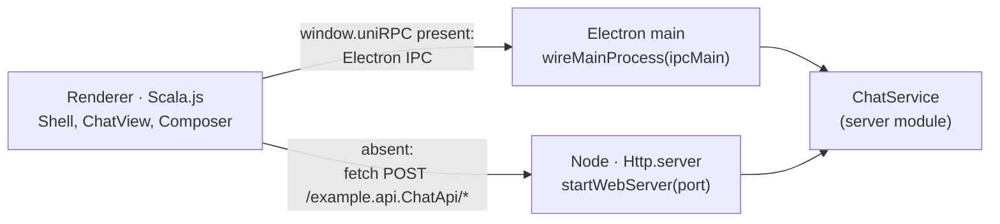

# Uni Harness: a chat workspace for Electron and the browser

A desktop-style app shell built with **Uni + Scala.js**: an icon rail, a foldable left sidebar, a
chat thread with a composer, and a right dock. The same renderer and the same service code run as
an [Electron](https://www.electronjs.org/) app and as a web app in a browser. Copy it as a starting
point for a chat or agent tool.




## What it shows

- **One service, two transports.** `ChatApi` (in `api/`) is implemented once by `ChatService` (in
  `server/`). Electron's main process serves it with `ElectronRPCServer.serve`; the web build serves
  it with `Http.server` on Node. The renderer installs `ElectronRenderer` when the preload bridge
  exists and otherwise keeps Uni's default fetch channel, so the calling code is identical.
- **A workspace UI in Rx HTML**, in Uni's teal and silver with the Uni logo, light and dark:
  - [`Shell.scala`](renderer/src/main/scala/example/renderer/Shell.scala): the icon rail and a
    foldable sidebar with chats (search, Today/Earlier groups), a file tree, and settings.
  - [`Chat.scala`](renderer/src/main/scala/example/renderer/Chat.scala): a welcome screen with
    prompt ideas, message bubbles with copy, replies that type themselves in, and the composer.
  - [`Dock.scala`](renderer/src/main/scala/example/renderer/Dock.scala): the right dock, with the
    conversation, an animated call-path diagram, and a live log of every RPC call and its timing.
- **Layout state that persists.** The sidebar and dock state, the active view, and the theme are
  `Storage.local` variables, so they survive a reload.
- **Keyboard shortcuts.** `Keyboard.bindAll`: ⌘B / Ctrl+B folds the sidebar, ⌘⇧B / Ctrl+Shift+B
  toggles the dock, ⌘K / Ctrl+K searches chats.
- **A composer that respects IME input.** Enter sends, Shift+Enter adds a newline, and Enter during
  IME composition (Japanese, Chinese, Korean input) confirms the conversion instead of sending.
- **A native-feeling window.** On macOS the Electron window hides its title bar; the top bars are
  drag regions and the rail leaves room for the window buttons.

The assistant is a mock that echoes your message after a short pause, so the example needs no API
key. Replace `ChatService.respond` with a call to your model or agent.

## Layout

| Path | What it is |
| --- | --- |
| `api/` | Scala.js: the `ChatApi` RPC trait and models |
| `server/` | Scala.js: `ChatService`, plus `wireMainProcess` (IPC) and `startWebServer` (HTTP) |
| `renderer/` | Scala.js: the UI and the transport choice |
| `src/main/index.js` | Electron main entry: creates the window, hands `ipcMain` to Scala |
| `src/preload/index.js` | `contextBridge` bridge: `window.uniRPC.request → ipcRenderer.invoke` |
| `src/renderer/` | `index.html`, the JS entry, the Tailwind theme (light and dark), and the Uni logo |
| `src/web/server.js` | Node entry for the web build: serves the UI and `ChatApi` |
| `electron.vite.config.mjs` | The Electron build (electron-vite + `vite-plugin-scalajs`) |
| `vite.web.config.mjs` | The web build: dev server with the `ChatApi` server, and the production bundles |

## Prerequisites

- JDK 17+ and `sbt` on your `PATH` (the Vite plugins shell out to `sbt`)
- Node.js 22+ and `pnpm`
- A locally published Uni snapshot for Scala.js:

  ```bash
  # from the Uni repo root
  ./sbt coreJS/publishLocal uniJS/publishLocal
  export SBT_OPTS="-Duni.version=<the version it printed>"
  ```

## Run

```bash
pnpm install

# Electron
pnpm dev            # compiles Scala.js, starts the renderer dev server, opens the window

# Browser
pnpm dev:web        # http://localhost:5180, with ChatApi on 127.0.0.1:5181 behind a Vite proxy
pnpm build:web      # out/web/public (static UI) and out/web/server/server.js
pnpm start:web      # serves both on http://127.0.0.1:8080 (set PORT to change it)
```

In `dev:web`, renderer changes reload on save; restart the command after changing `server/` code.
Set `UNI_HARNESS_WEB_PORT` / `UNI_HARNESS_RPC_PORT` to use other ports.

Open the browser app at port 5180, not 5173: `pnpm dev` serves the Electron renderer on 5173, and
that server has no HTTP `ChatApi` because Electron calls it over IPC.

## Package the desktop app

```bash
pnpm package        # electron-vite build, then electron-builder → dist/
```

See [App size](../../docs/http/electron.md#app-size) for how the packaging config keeps the bundle
small.

## Notes

- The web server binds to `127.0.0.1` and has no authentication. Add both before you expose it
  beyond your machine.
- Conversations live in memory and reset when the process exits.
