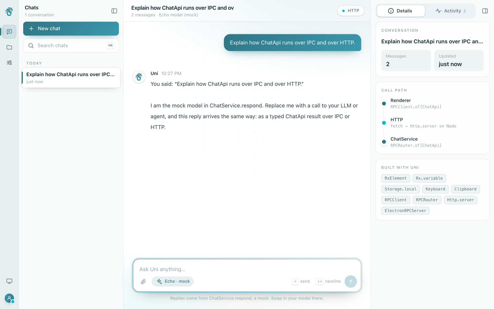
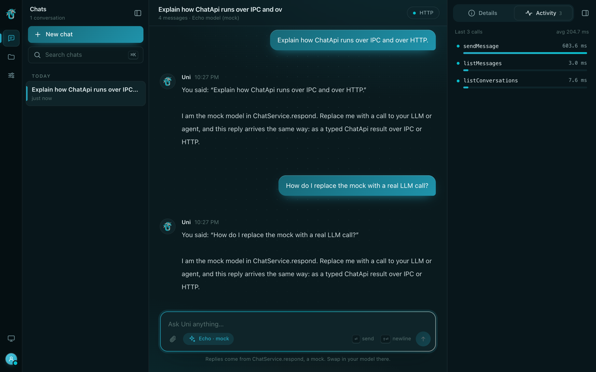
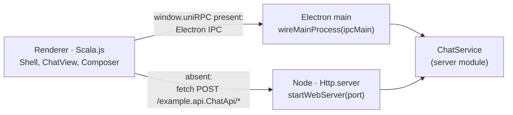

# Uni Harness: a chat workspace for Electron and the browser

A desktop-style app shell built with **Uni + Scala.js**: an icon rail, a foldable left sidebar, a
chat thread with a composer, and a right dock. The same renderer and the same service code run as
an [Electron](https://www.electronjs.org/) app and as a web app in a browser. Copy it as a starting
point for a chat or agent tool.







## What it shows

- **One service, two transports.** `ChatApi` (in `api/`) is implemented once by `ChatService` (in
  `server/`). Electron's main process serves it with `ElectronRPCServer.serve`; the web build serves
  it with `Http.server` on Node. The renderer calls it through the typed `ChatApiClient`, over IPC
  when the preload bridge exists and over fetch otherwise, so the calling code is identical.
- **State in two plain classes**, so components stay small and testable:
  - [`ChatStore`](renderer/src/main/scala/example/renderer/ChatStore.scala) holds chat data and
    actions over any `ChatApi`. It drops out-of-order thread responses and never shows a prompt
    twice. A streamed reply grows in one message, which keeps the key of its bubble when the stored
    reply replaces it. Each action returns a `Future`, so tests can await it.
  - [`Layout`](renderer/src/main/scala/example/renderer/Layout.scala) holds pane, view, theme, and
    width state: `Storage.local` variables in the app, plain `Rx.variable`s in tests.
- **Replies that stream in.** `ChatApi.streamMessage` returns `RxStream[ChatEvent]` (`Started`, `Delta`s,
  `Done`), and `ChatApiClient` calls it with `rpc.stream`, so every part of the reply arrives as
  the server writes it: as Server-Sent Events over HTTP, and on a stream channel over Electron IPC
  (the preload bridge's `stream` function). The dock's Activity log shows each stream's time to
  its first part and how many events it delivered.
- **Components that take only what they use.** `Composer(onSend, busy)`, `Bubble(message, current)`,
  and `IconRail(layout)`; `FoldablePane` and `ResizeHandle` (a styled grip on uni-dom's `PaneResize`) are shared by the sidebar and the dock.
  `TrackedChatApi` decorates the API to feed the dock's Activity log. Its **Table** view shows the same calls
  in a sortable uni-ui `DataTable` that moves by cell (arrow keys, Home and End).
- **A workspace UI in Rx HTML**, in Uni's teal and silver with the Uni logo, light and dark:
  - [`Shell.scala`](renderer/src/main/scala/example/renderer/Shell.scala): the title bar, the icon
    rail, and the resizable sidebar with chats (search, Today/Earlier groups), files, and settings.
  - [`Chat.scala`](renderer/src/main/scala/example/renderer/Chat.scala): a welcome screen with
    prompt ideas, message bubbles with copy, replies that grow as they stream in, and the composer.
  - [`Dock.scala`](renderer/src/main/scala/example/renderer/Dock.scala): the resizable right dock, with the
    conversation, an animated call-path diagram, and a live log of every RPC call and its timing.
- **A terminal in the dock.** The Terminal tab runs your shell in a pty (Electron) or a demo shell
  (browser), drawn by Uni's pure-Scala emulator and `TerminalView`. zsh and bash start with
  [`ShellIntegration`](server/src/main/scala/example/server/ShellIntegration.scala), which loads
  your own startup files and then emits OSC 133 marks, so each prompt shows a green or red marker,
  ⌘↑/⌘↓ (Ctrl+Shift+↑/↓) jump between prompts, and a failed command offers **Explain error**, which
  asks the chat about the command and its output. Set `UNI_HARNESS_NO_SHELL_INTEGRATION=1` to
  start the shell unchanged.
- **Keyboard shortcuts.** `Keyboard.bindAll`: ⌘B / Ctrl+B folds the sidebar, ⌘⇧B / Ctrl+Shift+B
  toggles the dock, ⌘K / Ctrl+K searches chats.
- **A composer that respects IME input.** Enter sends, Shift+Enter adds a newline, and Enter during
  IME composition (Japanese, Chinese, Korean input) confirms the conversion instead of sending.
- **A native-feeling window.** On macOS the Electron window hides its title bar; a 40px strip
  holds the window buttons and drags the window.

The assistant is a mock that echoes your message a word at a time, so the example needs no API key.
Pass your model's token stream (`String => Rx[String]`) to `ChatService(respond = ...)` to make it
real, or wrap a model that answers at once with `ChatService.atOnce`.

## Let an AI agent drive it

`pnpm dev:agent` starts the app with `--agent-bridge`. The renderer installs uni-ui's `UiAgent` and
serves it to the main process over Electron IPC (`ElectronRenderer.serve`). The main process then
serves it as MCP tools (`snapshot`, `query`, `act`, `changes`) at a local URL and prints it with a
fresh token:

```text
Agent bridge (MCP over HTTP): http://127.0.0.1:<port>/mcp
  Authorization: Bearer <token>
  claude mcp add --transport http uni-harness http://127.0.0.1:<port>/mcp --header "Authorization: Bearer <token>"
```

Run the printed `claude mcp add` line, then ask the agent to fold the sidebar or switch the dock tab.
The endpoint listens only on 127.0.0.1 and rejects requests without the token. Each launch picks a
new port and token. Plain `pnpm dev` starts no endpoint.

## Test

The Scala.js modules are projects in the Uni repository's root build, so CI compiles and tests them
with the rest of Uni. From the repository root:

```bash
./sbt exampleHarnessServer/test     # ChatService on Node
./sbt exampleHarnessRenderer/test   # ChatStore and components in headless Chromium (Playwright)
```

The tests use the real `ChatService` in-process instead of mocks. `ChatStoreTest` holds chosen
responses back to make RPC results arrive late or out of order; `ComponentTest` renders components
with `wvlet.uni.dom.testing` and drives them with DOM events (Enter, Shift+Enter, IME, drag to
resize, rail clicks).

## Prerequisites

- JDK 17+. The Vite plugins run the repository's `./sbt` in the repository root to link the
  Scala.js modules, so the example always builds against the Uni source next to it and needs no
  global sbt. On Windows, or in a copy outside the repository, they run the `sbt` on your `PATH`.
- Node.js 22+ and `pnpm`

To start your own app from this example outside the repository, copy the folder, add a `build.sbt`
with the three projects (`api`, `server`, `renderer`) that depend on
`"org.wvlet.uni" %% "uni" % "<version>"`, and set `ROOT` in the two Vite configs to `'.'`.

## Run

```bash
pnpm install        # also downloads the Electron binary (pnpm exec install-electron)

# Electron
pnpm dev            # compiles Scala.js, starts the renderer dev server, opens the window

# Browser
pnpm dev:web        # http://localhost:5180, with ChatApi on 127.0.0.1:5181 behind a Vite proxy
pnpm build:web      # out/web/public (static UI) and out/web/server/server.js
pnpm start:web      # serves both on http://127.0.0.1:8080 (set PORT to change it)
```

In `dev:web`, renderer changes reload on save; restart the command after changing `server/` code.
Set `UNI_HARNESS_WEB_PORT` / `UNI_HARNESS_RPC_PORT` to use other ports.

Open the browser app at port 5180, not 5173: `pnpm dev` serves the Electron renderer on 5173, and
that server has no HTTP `ChatApi` because Electron calls it over IPC.

## Package the desktop app

```bash
pnpm package        # electron-vite build, then electron-builder → dist/
```

See [App size](../../docs/http/electron.md#app-size) for how the packaging config keeps the bundle
small.

## Notes

- The web server binds to `127.0.0.1` and has no authentication. Add both before you expose it
  beyond your machine.
- Conversations live in memory and reset when the process exits.
