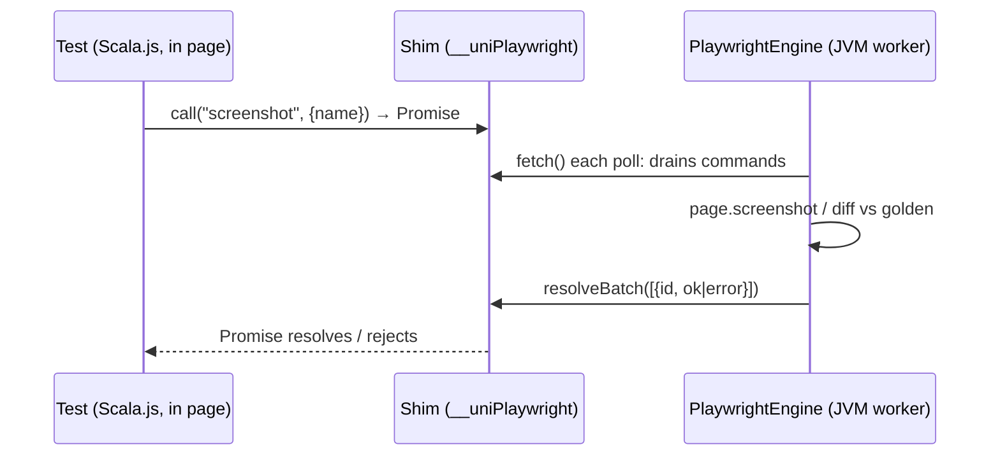

# Playwright command bridge for Scala.js tests

## Goals

- Let Scala.js test code running **inside** the Playwright page call JVM-side Playwright `Page`
  APIs. Today only the engine can touch the `Page`, so tests cannot take a screenshot, use
  trusted input, or resize the viewport.
- First PR: `screenshot` and `expectScreenshot` (visual regression against golden PNGs).
  Follow-ups reuse the same channel for input events (`click`, `hover`, `keyboard`) and viewport.
- Add no new dependencies: no Node.js and no image library. Image diffing uses JDK `ImageIO`.

## Background

- `uni-jsenv-playwright` runs the linked test JS in a page. `JsBridge` installs a shim that
  buffers console output, errors and `scalajsCom` messages. `PlaywrightEngine` polls the shim
  every 100ms with `page.evaluate(fetch)` on a single worker thread, because Playwright is not
  thread-safe (see `adr/2026-06-26-uni-jsenv-playwright.md`).
- The channel only carries the Scala.js test-protocol messages. There is no path from test code
  to the `Page`, so the only screenshot is the one taken after an uncaught JS error.
- Java Playwright has no `toHaveScreenshot`. That assertion exists only in `@playwright/test`
  (Node), so visual comparison has to be our own.
- Release coupling: the main build loads `uni-jsenv-playwright` in its metabuild at the
  **released** `UNI_PLUGIN_VERSION`, compiled with sbt's metabuild Scala (3.8.x, see
  `adr/2026-09-03-sbt-uni-in-process-uni-pin.md`). `uni-dom-test` cannot use a new JSEnv
  feature until the next release bumps that pin.
- UniTest already supports async tests: a test body may return a `Future`, which is required
  because every bridge call is a round trip through the poll loop.

## Design

**Lane: Standard.** This adds new user-facing test APIs and a new JSEnv protocol, and it lets
page code write files on the JVM side (a security boundary).



1. **Shim (`JsBridge`)**
   - Add `globalThis.__uniPlaywright = { version, call(cmd, args) }`. `call` pushes
     `{id, cmd, args}` onto a `commands` buffer and returns a Promise kept in a pending map.
   - `fetch()` also returns `commands`. A new `resolveBatch(results)` settles the pending
     Promises with `{id, value}` or `{id, error}`.
   - `version` is a protocol integer (starting at `1`). The client checks it so that an old
     JSEnv paired with a newer client fails with a clear message instead of hanging.
2. **Engine (`PlaywrightEngine`)**
   - In `pump`, run each drained command on `session.page` on the worker thread, then deliver
     all results in one `resolveBatch` evaluate.
   - Errors are returned to JS as rejections. They do not fail the run, so a failed assertion
     fails only its own test.
   - While a command is in flight or one was just served, poll every ~10ms instead of 100ms, so
     chains of commands stay fast.
   - Command dispatch lives in a new `PageCommands` object (a `cmd` name → handler table), which
     keeps the engine focused on the run loop.
3. **Commands in the first PR**
   - `screenshot {name, selector?, fullPage?}` writes `<screenshotDir>/<name>.png` and returns
     the absolute path. When `selector` is set, it captures `page.locator(selector).screenshot()`.
   - `expectScreenshot {name, selector?, maxDiffPixelRatio?, threshold?}`:
     - The golden file is `<snapshotDir>/<name>-<browser>-<os>.png`. Font rendering differs by
       OS and browser, as in `@playwright/test`.
     - The diff decodes both PNGs with `ImageIO` and compares pixels with a per-channel
       `threshold` (default 0.1). It passes when the differing-pixel ratio is at most
       `maxDiffPixelRatio` (default 0) and the sizes match.
     - On mismatch, it writes `<name>-actual.png` and `<name>-diff.png` (changed pixels in red)
       under `screenshotDir` and rejects with the paths and the ratio.
     - When the golden is missing, it writes the actual image as the golden and **fails**, the
       same as `@playwright/test`, so a missing golden never passes silently.
     - In update mode, it overwrites the golden and passes.
   - **Path safety:** `name` must match `[A-Za-z0-9._-]+` and must not contain `..`. Paths are
     resolved and checked to stay under the configured directory. The page is test code, but this
     is still a channel that lets JS write files.
4. **Config (`PlaywrightConfig`)**
   - New fields `screenshotDir` (default `target/uni-playwright/screenshots`), `snapshotDir`
     (default `src/test/screenshots`) and `updateSnapshots` (default `false`).
   - Each gets a `withXXX` setter. The env var `UNI_PLAYWRIGHT_UPDATE_SNAPSHOTS=1` also turns on
     update mode.
   - Viewport (default 1280×720) and `deviceScaleFactor` (default 1) are fixed explicitly in
     `browser.newContext`, so goldens do not depend on the host's defaults.
5. **sbt plugin**
   - New settings `uniPlaywrightScreenshotDir` (default `target.value / "uni-playwright" /
     "screenshots"`), `uniPlaywrightSnapshotDir` (default `(Test / sourceDirectory).value /
     "screenshots"`) and `uniPlaywrightUpdateSnapshots`.
   - All of them are passed as absolute paths, so results do not depend on the JVM's working
     directory in multi-project builds.
6. **Client API (Scala.js), in `uni-test`'s `.js` sources as `wvlet.uni.test.playwright.Playwright`**
   ```scala
   test("dialog renders") {
     mount(dialog)
     Playwright.expectScreenshot("dialog-open", selector = "#dialog")  // Future[Unit]
   }
   ```
   - It is a thin wrapper over `js.Dynamic.global.__uniPlaywright` and returns `Future`s.
     `Playwright.isAvailable` lets a test skip itself outside the Playwright env (for example on
     Node.js). Calling the API when the env is absent fails with a message that names the env.
7. **Testing and rollout**
   - The `sbt-uni-playwright` scripted test calls the raw `__uniPlaywright` protocol. It covers a
     screenshot file being written, a golden pass, a forced mismatch that rejects, a missing
     golden that fails, update mode, and a path-traversal name that is rejected. JVM unit tests
     cover the pixel diff.
   - The `uni-test` client gets a Node.js test for the "not available" path.
   - `uni-dom-test` adopts the bridge in a follow-up PR after the release that bumps
     `UNI_PLUGIN_VERSION`.
   - Add an ADR that records the protocol, the path rules and the golden naming.

## Alternatives and Why Not?

- **`page.exposeFunction` / `exposeBinding` as the channel.** This is simpler on the JS side, but
  its callback runs inside a Playwright dispatch. Calling `page.screenshot` from inside it is
  reentrant, which is what the polling design deliberately avoids. Reusing the existing poll
  loop keeps every Playwright call in one place on one thread.
- **Write JVM-side Playwright tests against the linked bundle.** These get the full API without a
  bridge, and they suit end-to-end app flows (a later sbt task could link, serve and hand the URL
  to JVM tests). They lose in-page component testing in Scala.js, though, which is the gap here.
  This is a complement, not a replacement.
- **Node.js `@playwright/test` for screenshot assertions.** This would add a Node/npm dependency,
  which the JSEnv was built to avoid.
- **Client inside the `sbt-uni-playwright` build.** That build has no Scala.js projects and is
  compiled for the metabuild Scala. A new Scala.js artifact there adds a third publishing shape
  for a ~100-line wrapper. Keeping the client in `uni-test` matches where assertions live, and
  the protocol version guards against version skew.
