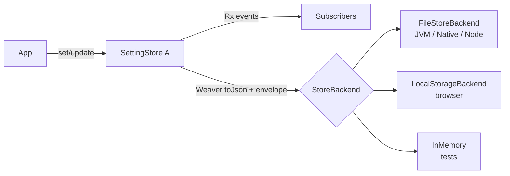

# SettingStore: zustand-style persisted settings for Uni

## Goals

- Give Uni apps (CLI tools, servers, Electron/Scala.js UIs) a one-line way to keep user settings across restarts, the way Treasure Work uses zustand + its `persist` middleware.
- Reuse what Uni already has (`RxVar`, `Weaver`, `FileSystem`, `dom.StorageVar`) instead of adding a new state-management framework.
- Decide the API shape, where settings files go by default, and how schema changes (versions/migrations) work.

## Background

What zustand + `persist` provides, and the Uni piece that already covers each:

| zustand                                  | Uni today                                      |
|------------------------------------------|------------------------------------------------|
| `create(set => ...)` store               | `RxVar[A]` (`set`, `update`, `get`)            |
| `subscribe`, selectors                   | `Rx` operators: `map`, `foreach`, `subscribe`  |
| `createJSONStorage`, serialization       | `Weaver[A]` (`derives Weaver`, `toJson`/`fromJson`) |
| `localStorage` storage                   | `wvlet.uni.dom.StorageVar` (JS only; primitive codecs; cross-tab sync) |
| file storage (Electron main, Node)       | `wvlet.uni.io.FileSystem` (JVM/Native/Node)    |
| `version` + `migrate`                    | missing                                        |
| `merge` (fill new fields with defaults)  | case-class default params in `Weaver` decode   |
| hydration state (async storage)          | not needed: file and localStorage reads are synchronous |

The missing parts are a cross-platform storage abstraction, a versioned on-disk envelope, and one constructor that ties these together. `dom.StorageVar` only supports `String`/`Int`/`Long`/`Double`/`Boolean` through `StorageCodec`, and only in the browser.

## Design

Lane: **Standard**. This adds a new public API and picks default on-disk storage paths (an always-gate area).

- **`SettingStore[A]`** (new package `wvlet.uni.config` in the `uni` module, because it needs `Weaver`) extends `RxVar[A]`. Every `set`/`update` writes the encoded value through to the backend. `clear()` deletes the stored entry and resets the value to the default.

  ```scala
  case class AppSettings(theme: String = "light", fontSize: Int = 14) derives Weaver

  val settings = SettingStore.of[AppSettings](
    "settings",
    AppSettings(),
    SettingStoreConfig("my-app").withVersion(2).withMigrate { (json, fromVersion) => ... }
  )
  settings.update(_.copy(theme = "dark"))   // persisted
  settings.map(_.theme).subscribe { t => ... } // selector-style subscription
  ```

- **`StoreBackend`** trait: `read(key): Option[String]`, `write(key, value)`, `remove(key)`, and optionally `watch(key)(onChange)`.
  - `FileStoreBackend(dir)` (JVM, Native, Node.js): one `<key>.json` file per key. Each write goes to a temp file and is then moved over the target, so a crash mid-write cannot leave a half-written file.
  - `LocalStorageBackend` (browser): uses `window.localStorage` and supports cross-tab sync through `storage` events, the same way `StorageVar` does.
  - `InMemoryStoreBackend` for tests.
  - The platform default is a file under the app config dir on JVM, Native, and Node, and localStorage in a browser (detected with `FileSystem.isBrowser`).
- **Locations**: `SettingStoreConfig(appName).withLocation(...)` selects one of several `SettingLocation`s:
  - `SettingLocation.UserConfig` (the default): `~/.config/<app>/` on every OS. When `$XDG_CONFIG_HOME` is set, it uses `$XDG_CONFIG_HOME/<app>/` instead.
  - `SettingLocation.OSConfig`: the platform-native directory (`~/Library/Application Support/<app>` on macOS, `%APPDATA%\<app>` on Windows, and the XDG path on Linux).
  - `SettingLocation.Project(dir)`: `<dir>/.<app>/`, for settings that belong to one project.
  - `SettingLocation.Directory(path)`: any explicit path.
  - `withBackend(b)` replaces file storage entirely, for example with localStorage or the in-memory backend.
- **Envelope and migrations**: the stored data looks like `{"version": 2, "state": {...}}`, matching zustand's format. On load:
  - If the stored version is lower than the configured one, the backend calls `migrate(stateJson: JSONValue, fromVersion: Int): JSONValue` before decoding, then writes the migrated value back.
  - Fields missing from the stored data take their case-class defaults (this is zustand's `merge`). Unknown fields are ignored.
- **Failure policy**: if the stored data is corrupt or fails to decode, the store logs a warning, renames the file to `<key>.json.corrupt-<timestamp>` so nothing is lost silently, and starts from the default. Write errors are logged and the in-memory value is kept. Neither case throws from `set`.
- **Partial persistence (zustand `partialize`)**: not added. Put only the fields to persist in the `SettingStore`, and keep transient UI state in plain `RxVar`s. That keeps the API small.
- **External changes**: off by default. `withWatchChanges(true)` uses `IOWatch` (file backend) or `storage` events (browser) to reload the value when another process or tab changes it.
- **`dom.StorageVar`**: left unchanged. A later PR can rebase it on `LocalStorageBackend`.
- **Docs**: add a "Persisted settings" section to the docs, plus entries in `docs/guide/for-ai-agents.md` and the `plugins/uni` skill (bumping the plugin version), with compiled snippets.



## Alternatives and Why Not?

- **Port zustand itself (a store with actions plus a middleware chain)**: in Scala, `RxVar` plus ordinary methods already play the role of a zustand store. A middleware layer would add concepts without adding capability.
- **Extend `dom.StorageVar` only**: this covers the browser case but not CLI/server/Electron-main apps, and it has no versioning.
- **Use a Typesafe Config / HOCON file**: HOCON fits read-only app configuration well. Persisted settings, though, are values the app writes back, and `Weaver` already gives typed round-tripping with no new dependency.
- **Debounced or async writes**: settings change rarely, so synchronous writes keep behaviour predictable, and there is no hydration state to track. A `withWriteDelay` option can be added later if a high-frequency use case shows up.
