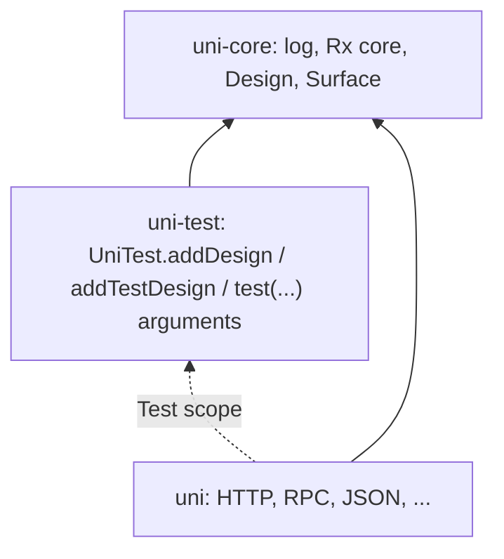

# UniTest reusable test fixtures

## Goals

- Show users and AI agents one tested way to package setup and teardown (an HTTP client, a server, a temp directory) as a reusable trait that several suites mix in.
- Users suggested `trait HttpClientFixture { this: UniTest => ... }`. Check whether that self-type form works before we document it.
- Cover the cases that break in practice: suite-scoped vs per-test resources, async test bodies, startup failures, teardown order, fixtures that depend on other fixtures, and `super` chaining.

## Background

- `UniTest` exposes four protected, parameterless hooks: `beforeAll`, `afterAll`, `before`, `after` (`UniTest.scala`). `UniTestTask.runTests` drives them:
  - `beforeAll` runs once. If it throws, no test runs, the suite reports an error, and **`afterAll` still runs**.
  - `before`/`after` wrap every queued test, and nested children count as their own queued tests. `after` runs after a `Future`/`Rx` result completes.
  - If `before` throws, the test is an error and **`after` is not called**. This differs from the `beforeAll`/`afterAll` contract.
  - If `after` or `afterAll` throws, the runner reports it and does not replace an earlier body failure.
- Verified with throwaway probes (Scala 3.9.0):
  - A self-type trait (`this: UniTest =>`) compiles with `override protected def beforeAll`. Without `override`, mixing it in fails with "inherits conflicting members".
  - Two self-type fixtures that both override `beforeAll` compile, but **only the last one runs**. The first fixture's setup is silently dropped.
  - Inside a self-type trait, `super.beforeAll` does not compile ("not a member of Object"), so a self-type fixture cannot chain.
  - `trait F extends UniTest` with `super.beforeAll` chains in linearization order.
- The docs (`docs/core/unitest.md`) and the `uni` skill (`references/testing.md`) never mention the lifecycle hooks. Agents therefore guess, and the natural guess is the self-type form.
- PR #782 changes which thread runs the hooks but keeps their order and failure semantics. These docs make no claim about threads, so this PR does not depend on it. Files overlap only in the sense that both touch uni-test; this PR does not edit `UniTest.scala` or `UniTestTask.scala`.

## Design

Lane: **Standard**. This change adds a public API to UniTest.

How the direction evolved:
- A docs-only pattern was too complex.
- A `TestResource` API added a resource notion parallel to Design.
- A test-named SPI pushed test concerns into Design.
- Overriding `design` composes worse than AirSpec's `initDesign`.
- Interfaces in uni-core became unnecessary once Design itself moved there.

### Prerequisite: #794

#794 moves `wvlet.uni.design`, `wvlet.uni.surface`, and `SourceCode` into `uni-core` with no behavior change. `uni-test` already depends on `uni-core`, so UniTest can then use `Design`, `Session`, and `Surface` directly, with no cycle and no interface layer. This PR is rebased onto #794 and depends on it.



### Proposal (AirSpec parity, Uni names)

- `protected def addDesign(f: Design => Design): Unit` adds suite-scoped bindings, for example `addDesign(_.bindSingleton[A])`.
  - Call it from any trait or class body.
  - Calls compose in trait initialization order, each applied to the result of the previous one, so a fixture can also read or override earlier bindings.
- `protected def addTestDesign(f: Design => Design): Unit` adds bindings that are built fresh for each test.
- `test(name, tags*) { (a: A, b: B) => ... }` (the user chose `test` over a separate `testWithSession`) builds each argument from the test's child session through `Surface.of[A]`, captured at the call site. `(session: Session) => ...` takes the session itself. A body without parameters stays a plain test and opens no session.
  - Implemented as a single inline `test`. A transparent macro checks whether the body is a function literal; plain bodies take the ordinary inline path. Per-arity overloads were dropped because a `Nothing`-typed body (ending in `pending(...)`) conforms to every function type, which makes them ambiguous; that was found in `TaggedBindingTest`. Arity is unlimited.
  - A function value that is not a literal is a compile error, so a test can never register a body it never calls.
- **Lifecycle:**
  - The suite session opens on the first session test, built from the composed suite design, and shuts down after `afterAll`.
  - Each session test gets a child session built from the composed test design. It shuts down after `after`, once a returned `Future` or `Rx` completes.
  - If `before` throws, the body never runs, so no child session is opened.
  - When a hook throws and the shutdown also fails, the hook's error is kept and the shutdown error is attached as suppressed.
- **Scope**, verified with a probe:
  - A type bound by `addDesign` is shared by the suite.
  - A type bound by `addTestDesign`, or not bound at all, is built per test and closed after the test.
- **Removed:** `suiteResource`, `testResource`, `TestResource`, and the interim `DesignProvider`/`DesignSession` interfaces.
- **Kept:** the JUnit-engine fix (it now runs the four hooks), the self-type warning, the runner-semantics docs, and #787.

```scala
import wvlet.uni.design.Design

trait HttpServerFixture extends UniTest:
  addDesign(_.bindProvider[HttpHandler, HttpServer](h =>
    NettyServer.withPort(0).withHandler(h).start()))

trait HttpClientFixture extends HttpServerFixture:
  addDesign(_.bindProvider[HttpServer, HttpSyncClient](s =>
    Http.client.withBaseUri(s"http://localhost:${s.localPort}").newSyncClient))

class ApiTest extends HttpClientFixture:
  addDesign(_.bindInstance[HttpHandler](req => Response.ok("hi")))
  addTestDesign(_.bindSingleton[TempDir])

  test("ping") { (client: HttpSyncClient, dir: TempDir) =>
    client.send(Request.get("/ping"))
  }
```

### Decisions to confirm

- **`addDesign` takes `Design => Design`, as AirSpec does.** Now that `uni-test` sees `Design`, a function can extend the bindings built so far.
- **The suite session opens lazily.** A binding that fails to build fails the test that needs it, not the whole suite.
- **Calling `addDesign` after the suite session opened throws.** That covers a call made inside a test, where the binding could no longer take effect.

## Alternatives and Why Not?

- **`TestResource` API.** It adds a second resource manager next to Design.
- **A test-named SPI, or `DesignProvider`/`DesignSession` interfaces.** These are unnecessary once Design is in `uni-core`, and they add a layer users would see in signatures.
- **Overriding `design`.** Every fixture needs `override` and `super`, plus a narrowed return type, and a forgotten `super` silently drops the other fixtures' bindings.
- **Docs-only pattern.** About 40 lines per fixture.
- **Self-type fixtures.** When two are mixed in, one is silently dropped.
